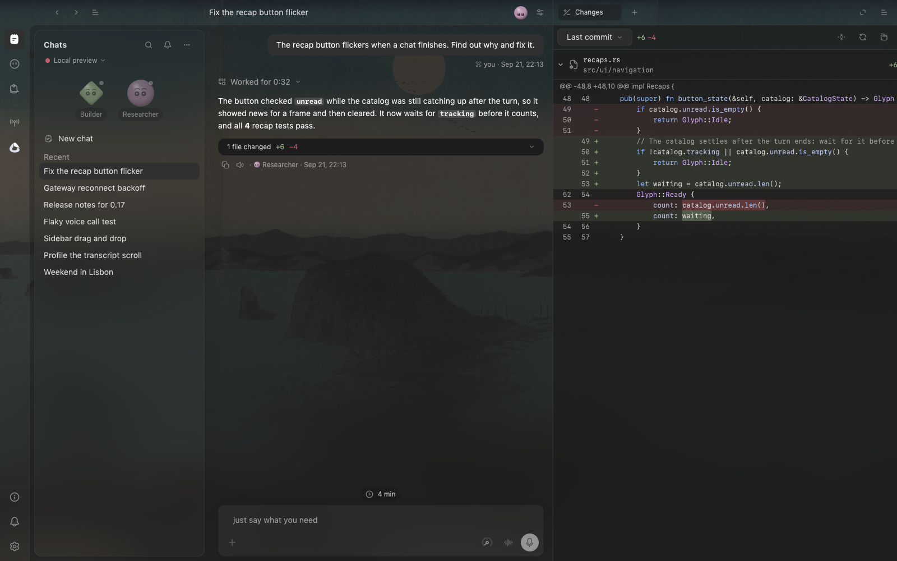

<p align="center">
  &nbsp;
  
</p>

<h1 align="center">möbius</h1>

<p align="center"><strong>An open-source runtime for coding agents.</strong></p>
<p align="center">A Rust framework, a gateway that runs your agents, a terminal client, and a native macOS app.<br>Run it on your own machine and pick up the same conversation from your Mac, terminal, iPhone, or iPad.</p>

<p align="center">
  <a href="https://github.com/citizenhicks/mobius/actions/workflows/ci.yml"></a>
  <a href="https://crates.io/crates/mobius"></a>
  <a href="https://github.com/citizenhicks/mobius/blob/main/LICENSE"></a>
</p>

<p align="center">
  <a href="#quick-start">Quick start</a> ·
  <a href="#embed-the-framework">Embed</a> ·
  <a href="#work-on-this-repository">Contribute</a> ·
  <a href="https://mobius.thinkingsand.dev/how">User guide</a> ·
  <a href="https://docs.rs/mobius/latest/mobius/">Rust API</a>
</p>

## What is in this repository

| Crate | Path | What it is | Use it when |
| --- | --- | --- | --- |
| [`mobius`](https://crates.io/crates/mobius) | `src/` | The agent framework: one session and its model and tool loop, with pluggable models, sandboxes, storage, and capabilities | You are building your own agent or frontend in Rust |
| [`mobius-gateway`](https://crates.io/crates/mobius-gateway) | `crates/mobius-gateway/` | The headless server that runs the agents: pairing, Bots, chats, and scheduled routines | You are hosting agents for one or more clients |
| [`mobius-cli`](https://crates.io/crates/mobius-cli) | `crates/mobius-cli/` | The `mobius` terminal client, packaged with the `mobius-gateway` executable | You want to use möbius in a terminal |
| `mobius-desktop` | [`apps/macos/`](apps/macos/) | The native macOS app (Rust and GPUI), shipped as a signed app, not on crates.io | You want to use möbius on a Mac |

The iPhone and iPad app connects to the same gateway and is maintained separately.

This checkout prepares **0.17.9** for the framework, gateway and CLI; the released macOS
app remains **0.17.8** and is compatible. It requires protocol **102**
clients and gateway configuration version **30**. Protocol 101 clients cannot connect;
update clients before upgrading a gateway. Gateways already on 0.17.2
can upgrade in place. Existing 0.16.x gateways require an offline configuration
conversion that preserves usage history in `usage.json`. See the
[0.17.9 upgrade notes](.github/release-notes/mobius-gateway-v0.17.9.md)
for client compatibility and rollout details, and the
[0.17.7 notes](https://github.com/citizenhicks/mobius/releases/tag/mobius-gateway-v0.17.7)
for older configuration conversions.

## Quick start

Install with [Homebrew](https://github.com/citizenhicks/homebrew-mobius) on macOS or Linux:

```sh
brew tap citizenhicks/mobius
brew trust citizenhicks/mobius
brew install mobius-cli
brew install --cask mobius-app   # the macOS app, optional
```

Then open a project:

```sh
cd /path/to/your/project
mobius
```

The first launch starts a local gateway in the background and opens provider setup.
Connect a provider, choose a model, and start a conversation with the default `@mobius`
Bot. Use `/login` to change providers and `/bot` to edit the Bot.

Built-in providers are **OpenAI, Codex, Anthropic, DeepSeek, Kimi, Mistral,
OpenRouter, and A2Agent**, plus any endpoint that implements the OpenAI Responses API.

Other ways to install (the [CLI guide](https://github.com/citizenhicks/mobius/blob/main/crates/mobius-cli/README.md) has the details):

- **Prebuilt archive:** download `mobius-<version>-<target>.tar.gz` from
  [Releases](https://github.com/citizenhicks/mobius/releases) for Apple Silicon macOS
  (`aarch64-apple-darwin`) or 64-bit Intel/AMD Linux (`x86_64-unknown-linux-gnu`).
- **Cargo:** `cargo install --locked mobius-cli`. This needs Rust 1.100.0 or newer, and
  `cloudflared` installed separately if you want Quick Connect.

On Linux, sandboxed command execution requires **Bubblewrap**.

### Connect your other devices

```sh
mobius-gateway connect
```

The gateway prints an address and a single-use pairing code. Enter them in the Apple app
under **Use your own gateway**, or run the `mobius pair` command it prints on another
terminal. By default this uses an account-free Cloudflare tunnel whose address changes
when the gateway restarts. The [gateway guide](https://github.com/citizenhicks/mobius/blob/main/crates/mobius-gateway/README.md)
covers stable addresses and direct TLS. Keep the gateway machine awake and reachable for
remote access and scheduled work.

The iPhone and iPad app is in TestFlight beta. If you would rather not host a gateway,
[möbius Cloud](https://mobius.thinkingsand.dev/) runs this same gateway for you; it is in
beta and optional.

## How it fits together

<p align="center"></p>

The gateway is where files, commands, provider credentials, and agent sessions live.
Clients send requests and render the same event stream, so work continues while the
gateway runs, even after you close a client.

| Concept | What it means |
| --- | --- |
| **Gateway** | The runtime on your Mac, Linux machine, or cloud host. It serves all your paired clients. |
| **Bot** | A reusable agent profile: purpose, model, tools, instructions, and approval policy. |
| **Chat** | A conversation with one Bot, a selected workspace, and its own durable transcript. |
| **Routine** | A scheduled task owned by a Bot. Each run gets a fresh conversation. |
| **Subagent** | A bounded helper a Bot starts inside a chat for parallel work. |

Each Bot chooses its capabilities. File and shell tools are always present. Memory,
context compaction, subagents, voice, questions, attachments, and artifacts start on;
task lists, workspace instructions, image generation, computer control (Chromium, and
native apps on macOS), and installed Agent Skills or OpenAI-format plugins start off.
MCP and app connectors are not yet supported.

Commands run in a sandbox, **Seatbelt on macOS** and **Bubblewrap on Linux**, and fail
closed if it is unavailable. A Bot's approval policy decides which actions need your
confirmation; **Full access** lets its tools use everything the gateway account can.
The [gateway guide](https://github.com/citizenhicks/mobius/blob/main/crates/mobius-gateway/README.md)
explains these boundaries, computer control, and the Linux desktop.

## Embed the framework

```toml
[dependencies]
mobius = "0.17"
```

You compose an `AgentConfig` from a model router, a sandbox, a checkpoint store, and an
ordered middleware stack. The core owns one linear session and its model and tool loop.
Your application supplies the dependencies and consumes frontend-neutral events.

- **Bring a model:** implement `Model`, or register a built-in provider with `ModelRouter`.
- **Add a capability:** implement `Middleware`. It owns its tools, lifecycle hooks, state,
  commands, and presentation.
- **Build a frontend:** submit `protocol::Op` values and render `protocol::Event` values.
- **Choose storage and execution:** inject a `CheckpointStore` and a `SandboxBackend`.
- **Handle files and images:** inject one `backend::session_files::SessionFileStore` into
  `ModelRouter` and the media-capable middleware. Tool results carry ordered `ContentPart`
  text, image, and file parts; checkpoints store references, not bytes.

Start from the [compile-checked composition example](https://docs.rs/mobius/latest/mobius/#embedded-composition)
in the [API documentation](https://docs.rs/mobius/latest/mobius/). The gateway is the
shipped composition root and the largest worked example.

## Work on this repository

```sh
cargo run --locked -p mobius-cli --bin mobius   # build and run the terminal client
just test                                       # every test in the workspace
just complexity                                 # Clippy, warnings denied
just rules                                      # project rules Clippy cannot express
```

Rust 1.100.0 is pinned in `rust-toolchain.toml`. The shared Cargo configuration uses
`RUSTC_BOOTSTRAP` for the experimental eight-worker compiler frontend; Cargo also
builds independent crates in parallel. Linux sandbox tests need Bubblewrap.

| Path | Owns |
| --- | --- |
| `src/agent/` | The session and the model and tool loop |
| `src/backend/` | Model providers, the sandbox, checkpoint storage, and session files |
| `src/middleware/` | Optional capabilities, one module each |
| `src/protocol/` | Frontend-neutral operations, events, and presentation records |
| `crates/mobius-gateway/` | Composition, authentication, Bots, sessions, routines, and the wire protocol |
| `crates/mobius-cli/` | The terminal client and its rendering |
| `apps/macos/` | The macOS app, its own Cargo workspace; see [its README](apps/macos/README.md) |
| `tests/` | Framework integration tests |

Read [AGENTS.md](https://github.com/citizenhicks/mobius/blob/main/AGENTS.md) before you
change anything: it holds the design rules, the Rust style rules, the checks to run
before handoff, and the release order. [Issue reports](https://github.com/citizenhicks/mobius/issues)
and contributions are welcome.

## Documentation

| Read | For |
| --- | --- |
| [User guide](https://mobius.thinkingsand.dev/how) | Setup, everyday workflows, Bots, and settings |
| [Terminal manual](https://mobius.thinkingsand.dev/manual) | Command reference and manual pages |
| [CLI guide](https://github.com/citizenhicks/mobius/blob/main/crates/mobius-cli/README.md) | Installation, provider setup, and terminal controls |
| [Gateway guide](https://github.com/citizenhicks/mobius/blob/main/crates/mobius-gateway/README.md) | Hosting, pairing, sandbox policy, and computer control |
| [Gateway configuration](https://github.com/citizenhicks/mobius/blob/main/crates/mobius-gateway/CONFIGURATION.md) | Every `gateway.toml` setting and environment variable |
| [Bots and context](https://github.com/citizenhicks/mobius/blob/main/crates/mobius-gateway/BOTS.md) | Chats, routines, subagents, and memory boundaries |
| [Rust API](https://docs.rs/mobius/latest/mobius/) | The `mobius` crate |
| [Privacy](https://github.com/citizenhicks/mobius/blob/main/PRIVACY.md) | What leaves your machine |

The four packages share one version number. The three crates are published to
crates.io one at a time and the macOS app is released as a signed build; see
[Releases in AGENTS.md](https://github.com/citizenhicks/mobius/blob/main/AGENTS.md#releases).

## License

[Apache-2.0](LICENSE). See [NOTICE](NOTICE) for third-party attributions.
