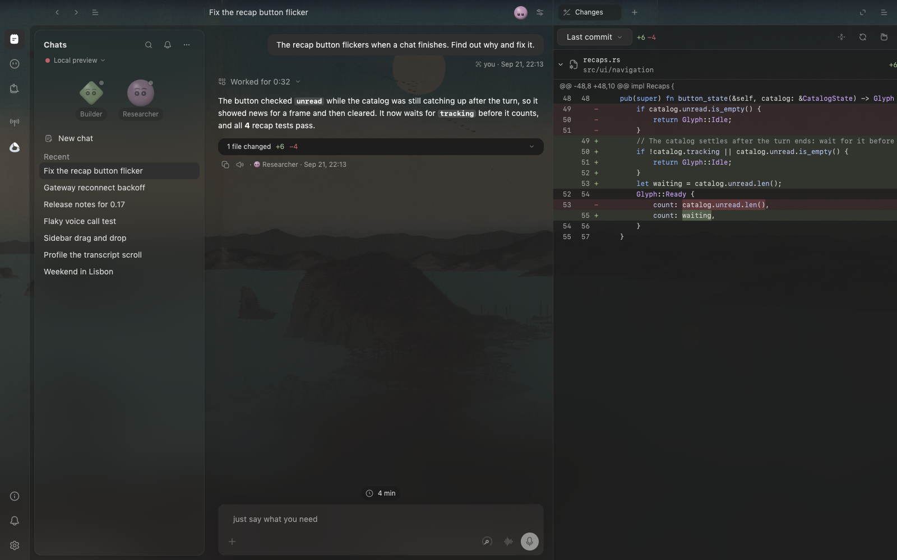

# möbius for macOS

The native macOS client for a möbius gateway, written in Rust with
[GPUI](https://www.gpui.rs). Chats open in the main page; files, changes, terminals and
browser tabs sit beside the conversation. The gateway owns sessions, tools, model
catalogs, approvals and transcript presentation; this app renders them and adds the
native pieces: dictation, voice, computer control and an embedded Chromium.



Install the signed build with Homebrew, or download it from
[Releases](https://github.com/citizenhicks/mobius/releases) (`mobius-desktop-v*`):

```sh
brew tap citizenhicks/mobius
brew install --cask mobius-app
```

It updates itself with Sparkle. It runs the local gateway by default and can pair with
any other gateway with a one-time code, or sign in to möbius Cloud.

## Build and run

Requires Apple Silicon, macOS 26+, Xcode command-line tools, Rust 1.99.0, CMake and
Ninja (`brew install cmake ninja`). The app is its own Cargo workspace and builds
against the framework and gateway in this repository (`../..`). Swift Package Manager
fetches the pinned, namespaced LiveKitWebRTC framework for native voice, and the first
build downloads the pinned Chromium (CEF) into `target/cef`.

```sh
cd apps/macos
cargo run --locked
MOBIUS_BUILD_PROFILE=dev scripts/bundle.sh
open target/bundle/möbius.app
```

`scripts/bundle.sh` builds a release bundle. Set `MOBIUS_SIGNING_IDENTITY` to a
Developer ID identity for distribution; development bundles are signed ad hoc. The
bundle carries the gateway, the native bridge, WebRTC, Chromium with its helper apps,
and icons, and runs without a source checkout. The build links to a signed bundle under
`~/Library/Caches`, outside Documents, so FileProvider cannot add metadata that breaks
the signature.

## Browser and native control

Browser tabs are Chromium through CEF: native views over the pane with the app's own
toolbar, one persistent profile and downloads to `~/Downloads`. Only the bundled app has
Chromium; `cargo run` starts without it. When the gateway runs on this Mac, a chat's
agent drives that chat's own tab instead of a headless browser, if its sandbox allows
network access, through a Unix socket under `~/Library/Caches/app.mobius.desktop` that
only that page answers. Chromium never opens a debugging port. Native voice uses a
namespaced WebRTC SDK so it can coexist with Chromium; every bundle is checked for
duplicate Objective-C classes.

Dictation, voice and computer control need the matching macOS permissions, and
computer control stays off until enabled in Settings. App actions return app-scoped
screenshots; full-display capture is an explicit `desktop.screenshot(displayId)`.

## Checks

```sh
cargo fmt --all -- --check
cargo clippy --workspace --all-targets --all-features --locked -- -D warnings
cargo test --workspace --all-targets --all-features --locked
RUSTDOCFLAGS="-D warnings" cargo doc --workspace --all-features --locked --no-deps
sh scripts/rules.sh
python3 scripts/check-native.py
```

`MOBIUS_SNAPSHOT=<dir> cargo run --features snapshot` renders the app's visual
scenarios to PNGs; `MOBIUS_SNAPSHOT_ONLY=readme-hero` renders the picture above from
fixture data only. Read the repository's [AGENTS.md](../../AGENTS.md) and this app's
[AGENTS.md](AGENTS.md) before changing anything.

## License

[Apache-2.0](LICENSE). Third-party fonts, icons, the noVNC viewer and the public-domain
background prints are listed in [assets/NOTICE](assets/NOTICE).
